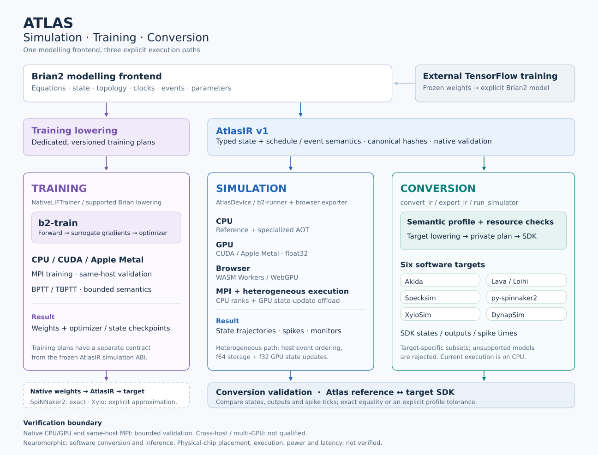

# Brian2 Atlas

Brian2 Atlas brings simulation, training and model conversion to the Brian2
modelling interface. It supports native CPU simulation, GPU/browser backends,
distributed MPI execution, native training, and experimental conversion to
software targets for neuromorphic chip ecosystems. AtlasIR is the shared
representation for execution and conversion. This repository contains the
product implementation and its regression tests.
[The preprint repository](https://github.com/RockLi/brian2-atlas-preprint) contains
the manuscript, historical experiments and reproduction materials.

Atlas retains the upstream Brian2 Git history, author attribution and
[CeCILL 2.1 licence](LICENSES/Brian2-LICENSE). Original Atlas engine code is
licensed under [Apache-2.0](LICENSE); the combined checkout retains the upstream
terms described in [license and repository scope](LICENSE_SCOPE.md). The migration baseline is Brian2 commit
`27b5431168cf9959f0c27894cd4d92cdc6ad5c31`.

## Architecture: simulation, training and conversion



Atlas exposes three capabilities through the Brian2 modelling interface:

- **Simulation** executes a model on CPU, GPU, browser or MPI backends. The
  heterogeneous MPI path can offload population state updates to a GPU while
  retaining event ordering on the host.
- **Training** lowers supported Brian models into dedicated training plans.
  `b2-train` runs the forward pass, surrogate-gradient backpropagation and
  optimizer on native CPU/GPU/MPI backends.
- **Conversion** checks an AtlasIR model against a neuromorphic target's semantic
  and resource constraints, then produces a target-specific plan for SDK
  execution. Atlas reference results provide the conversion check.

Simulation and conversion share **AtlasIR**; new exports use `atlasir-v1`.
Verified legacy imports remain supported (see [migration](brian2-rust/AtlasIR.md#7-migration-and-conformance)).
Native training currently uses
**separately versioned training plans**; it does not run through the frozen
`atlasir-v1` simulation ABI. The TensorFlow examples import frozen weights into an
explicit Brian2 model. A bounded [native LIF training bridge](brian2-rust/examples/neuromorphic/native_training/README.md)
now connects Atlas-trained networks to SpiNNaker2 software inference through
explicit quantization and AtlasIR. Arbitrary TensorFlow graphs and general
native training plans are not admitted by this bridge. A separate
[Xylo adaptation](brian2-rust/examples/neuromorphic/native_xylo/README.md) preserves
a small model's frozen weights but changes its neuron dynamics; it requires
explicit opt-in and reports cross-target differences. A new
[native integer Xylo trainer](brian2-rust/examples/neuromorphic/native_xylo_integer/README.md)
uses the target dynamics during training and exports without that adaptation.
This dedicated training plan currently runs on CPU only.

See the [architecture notes](brian2-rust/architecture/README.md) for interfaces and
validation boundaries. Figures: [PNG](brian2-rust/architecture/atlas-architecture.png),
[SVG](brian2-rust/architecture/atlas-architecture.svg).

## Install from source

This is research software version **0.1.0**, paired with the
[bioRxiv v1 evidence archive](https://github.com/RockLi/brian2-atlas-preprint/tree/biorxiv-v1).
Install the frozen source from tag `v0.1.0`; no PyPI publication is implied.
`main` holds the release snapshot and `dev` is the development branch. The distribution name is `brian2-atlas`; use `brian2` for modelling
and `brian2_atlas` for the Atlas backend. `brian2_rust` remains a compatibility
import. The Brian compatibility version is
`2.10.1.post241`, independent of the Atlas distribution version.

Use Python 3.12 or newer, Rust/rustup and a working C/C++ compiler:

```sh
git clone --branch v0.1.0 https://github.com/RockLi/brian2-atlas.git
cd brian2-atlas
rustup toolchain install 1.98.1 --profile minimal
python -m venv .venv
. .venv/bin/activate
python -m pip install .
```

A source install builds both `b2-runner` and `b2-train` with the locked Rust
sources. Platform wheels contain these executables and all runtime source
resources; installing a matching wheel does not rebuild them. Specialized AOT
simulation still needs the pinned Rust compiler. CUDA needs the NVIDIA toolkit
and CuPy; Metal needs the corresponding Apple compiler/runtime; MPI needs
`mpicc` and `mpiexec`.

The optional `brian2-rust/tools/install_user.sh` uses `uv` to create a coherent
user installation and expose `brian2-atlas-python`, `brian2-atlas`, `b2-runner`
and `b2-train`. Set `BRIAN2_ATLAS_HOME`, `BRIAN2_ATLAS_BIN` and
`BRIAN2_ATLAS_PYTHON` to choose its locations and interpreter. It records source
and binary provenance in `install.json` and refuses to overwrite unrelated
commands. It installs a snapshot; rerun after source changes.

Builds and caches can live on external storage using `CARGO_TARGET_DIR`,
`CARGO_HOME`, `UV_CACHE_DIR`, `PIP_CACHE_DIR`, `TMPDIR` and `XDG_CACHE_HOME`.
Installed runtime output goes to temporary directories; set
`BRIAN2_ATLAS_OUTPUT_DIR` to choose a persistent output parent. An explicit
`B2_RUNNER` or `B2_TRAIN_RUNNER` overrides the bundled executable.

## First simulation

```python
import brian2 as b
import brian2_atlas

b.set_device("atlas", engine="reference")
group = b.NeuronGroup(
    1, "dv/dt = (1.5-v)/(10*ms) : 1",
    threshold="v>1", reset="v=0", method="euler", dt=0.1*b.ms,
)
spikes = b.SpikeMonitor(group)
b.Network(group, spikes).run(100*b.ms)
print(spikes.num_spikes)  # 9
```

`brian2_atlas.AtlasDevice` is the public Brian2 Device. Select `atlas` once,
then choose the execution engine: `reference`, `aot`, `cuda`, `metal` or `mpi`.
For CUDA/Metal, also specify `numeric_mode="float32"`. Browser execution uses
the separate `export_wasm_bundle` API.

Existing `import brian2_rust`, `RustStandaloneDevice` and
`set_device("rust_standalone", ...)` remain compatible aliases of the same
implementation and Device instance. Internal Rust module paths and native
executable names are unchanged.

Use `engine="aot"` for model-specialized CPU execution. Backend capabilities
are checked explicitly; unsupported model constructs raise a capability error.
See [the backend guide](brian2-rust/README.md) for GPU, browser, MPI and training.

## Neuromorphic chip ecosystems: experimental conversion

`brian2_atlas.neuromorphic` converts validated AtlasIR into plans for six
neuromorphic software targets. Conversion preserves the admitted source
semantics and rejects unsupported constructs. These are development additions;
they are not included in the frozen `v0.1.0` release installed above.

| Chip ecosystem | Software target | Verified conversion scope |
|---|---|---|
| BrainChip Akida | Akida SDK simulator | Frozen signed/biased integer MLPs and binary count classifiers |
| Intel Loihi | Lava CPU simulation | Frozen integer MLPs with a uniform hidden shift, and binary count classifiers |
| SynSense Speck | Specksim | Restricted binary count classifiers |
| SpiNNaker2 | py-spinnaker2 Brian2 backend | Frozen integer MLPs, binary count classifiers and a bounded temporal LIF profile |
| SynSense Xylo Audio 2 | XyloSim | Binary count classifiers and bounded integer temporal dynamics |
| SynSense DYNAP-SE2 | Rockpool DynapSim | A bounded temporal DPI circuit-model profile |

The static inference path is **externally trained, frozen weights → Brian2
model → AtlasIR → target simulator**. Atlas runs the same source model as the
reference. Training through Atlas is a separate capability; this conversion
path does not perform on-chip learning or import arbitrary TensorFlow graphs.

The [native integer Xylo example](brian2-rust/examples/neuromorphic/native_xylo_integer/README.md)
trains a 16→64→4 network with Xylo integer dynamics from the start. On all
4,157 test digits 0–3, Atlas and XyloSim both reach **92.18%**, with zero
differences across 27,136,896 spike/current/membrane values. A smaller control
with the previous binary inputs and 16→32→4 dimensions reaches **77.63%**.
The larger gain also changes encoding, width and duration; these are four-class
results. The new model is not admitted by the current SpiNNaker2 LIF profile.

The earlier [same-weight native Xylo experiment](brian2-rust/examples/neuromorphic/native_xylo/README.md)
uses a 16→32→4 network on all 4,157 MNIST test digits 0–3. SpiNNaker2 matches
quantized native inference at **75.58%**; Xylo reaches **75.61%**, but 234
predictions differ. This is an explicit dynamics adaptation, not exact native
LIF conversion. The adapted AtlasIR itself matches Xylo's state/spike records
on the documented replay subset.

A separate [native training example](brian2-rust/examples/neuromorphic/native_training/README.md)
trains both layers of a small MNIST SNN in Atlas, freezes and quantizes its
weights, and exports through AtlasIR to SpiNNaker2. On the full MNIST test split,
accuracy is **94.53% before quantization and 93.80% afterward**; SDK inference
also reaches **93.80%**, with all 11,840,000 spike-raster entries matching native
Atlas. The audit separates quantization loss from conversion loss. This is a new temporal SNN,
with different preprocessing and architecture from the TensorFlow models below.

The [character language-model example](brian2-rust/examples/neuromorphic/language_model/README.md)
trains a 129→128→32 LIF model in Atlas to predict the next character from a
fixed four-character context. On its 9,996 held-out targets, perplexity is
**8.09 before quantization and 9.92 afterward**, versus **11.43** for a
training-only bigram baseline. SpiNNaker2 also reaches **9.92** with exact
per-token logits, probabilities and spikes; 32 autoregressively generated
characters match too. Each prediction starts from zero neuron state. This
validates a bounded language-model conversion, not general LLM or persistent
recurrent-state support.

Two externally trained MNIST test-set results are available:

- The original TensorFlow-trained **784→256→10 MLP reaches 98.74%** on Akida,
  Lava and SpiNNaker2 with the same frozen model and weights. The latest
  SpiNNaker2 run matches a fresh native Atlas replay on all **2,660,000 hidden
  and output states** across 10,000 images. Its optimized encoding reduces
  first-layer connections by 94.5%.
  [Full-model result and reproduction](brian2-rust/examples/neuromorphic/spinnaker2_dense/README.md).
- A separate, smaller binary count model reaches **90.03%** on Akida, Lava,
  Specksim, SpiNNaker2 and XyloSim, with exact conversion equivalence.
  [TensorFlow example](brian2-rust/examples/neuromorphic/README.md) and
  [additional count targets](brian2-rust/examples/neuromorphic/count_targets/README.md).

All of these results use **software execution**. Hardware placement, physical
chip execution, power and latency remain unverified. Simulator admission also
does not guarantee hardware fit; for example, the Xylo count MNIST encoding
exceeds the chip's input-channel limit. The temporal profiles have their own
state and spike checks; static classifier encodings do not establish general
SNN portability.

The [compatibility checklist](brian2-rust/examples/neuromorphic/COMPATIBILITY.md)
records supported features, numeric limits, rejected combinations and execution
evidence for each target.

## Validation and support scope

The migration has run on macOS arm64/Python 3.14 with actual CPU/AOT, Apple
Metal and same-host MPI, and on a Modal NVIDIA L4 with CUDA simulation/training.
Chrome WASM Workers and a non-fallback Apple WebGPU adapter were exercised.
Source-directory, wheel and isolated-sdist installs passed representative
simulation, training and fresh-process checkpoint checks on macOS arm64.

The [CUDA follow-up](migration/cuda-cutoff-followup.json) passed all 708 previously
skipped cases from 15 modules plus one ABI regression on a Modal L4 (709 passed,
zero failed or skipped), including two MPI ranks sharing that GPU.

These results do not qualify every model, device, CUDA test variant, Windows,
cross-host MPI or multiple GPUs. The hosted CI configuration covers Linux and
macOS distribution builds; its results must be checked separately. Exact source
identities, numerical gates, skipped cases and known validation limits are in
[the migration records](migration/README.md).

```sh
python -m pip install -e '.[test]' scipy pyarrow
python dev/atlas/run_frontend.py
python dev/atlas/run_backend.py --suite cpu --timeout 1200
```

Training source tests need a built `b2-train`; hardware suites are opt-in.
`dev/atlas/check_installed.py --report /path/to/report.json` verifies an installed
package, and `--metal` adds actual Metal training. Run it with an installed
interpreter and without `PYTHONPATH`, `B2_RUNNER` or `B2_TRAIN_RUNNER` overrides.

## Upstream and research provenance

The `dev` branch is the Atlas development branch. The upstream project is
[brian-team/brian2](https://github.com/brian-team/brian2); product ports retain
source hashes and adaptation notes. Historical paper results remain tied to the
source versions that produced them. The [PD14 reproduction](https://github.com/RockLi/brian2-atlas-preprint/tree/main/experiments/reproduction/pd14)
pins Atlas commit `b769c21004a89e2a6f3a14521f23012db654aadd` and has passed its
documented bounded build-to-simulation checks. The `v0.1.0` release is frozen;
development changes and their acceptance records do not alter that release or
the paper's measured implementation identities.

The current `dev` training increment extends stochastic callback and whole-neuron
lowering, selected Poisson semantics and read-only state handling. See the
[training guide](brian2-rust/TRAINING.md) and the
[incremental acceptance records](https://github.com/RockLi/brian2-atlas-preprint/tree/dev/validation/training-port-f73).

## Optional dependencies

The `examples` extra retains the original joblib, noise, OpenCV, progressbar2 and SBI dependencies; the `cloud` extra installs the Modal SDK. From a checkout, install these as needed with `python -m pip install ".[examples]"` or `python -m pip install ".[cloud]"`. Core installation does not install either group. `uv.lock` retains the captured dependency versions with the Atlas distribution identity; use `uv sync --locked` and select extras explicitly when using uv. A resolved optional dependency is not a claim that its integration was exercised on every supported Python/platform combination.

User simulation, training and MPI checkpoint commands are collected in the [source example guide](brian2-rust/examples/README.md). Run their bounded regression suite with `python dev/atlas/run_backend.py --suite examples`.

## AtlasIR

[AtlasIR](brian2-rust/AtlasIR.md) is the shared intermediate representation for Atlas execution. Brian2 is the current modeling frontend. Python integrity/serialization APIs are available through `brian2_atlas.ir`. Frozen `b2ir-*` wire and ABI identifiers remain compatible; public native-function registrations also accept `atlasir-*` names.

## Citation

Use [CITATION.cff](CITATION.cff) to cite Atlas, recording the exact commit used.
The upstream Brian2 citation is retained in [UPSTREAM_CITATION.cff](UPSTREAM_CITATION.cff).

## Public evidence exports

Host-specific paths have been replaced with synthetic locations in the published
history. Original evidence is privately preserved with its original checksums.
The [redaction map](migration/public-path-redaction.json) binds original content
hashes to the public export hashes; a redacted export is not byte-identical to
the original measurement artifact. Configure actual input/output locations when
running historical scripts. The [commit map](migration/public-commit-map.json)
resolves original commit identities to the public history.
